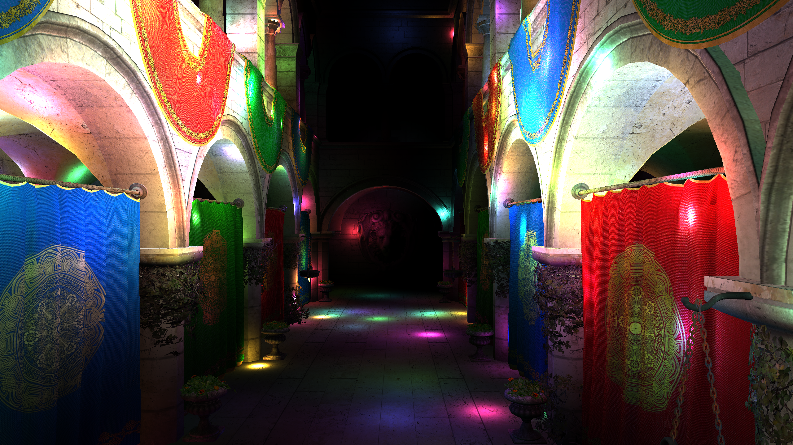
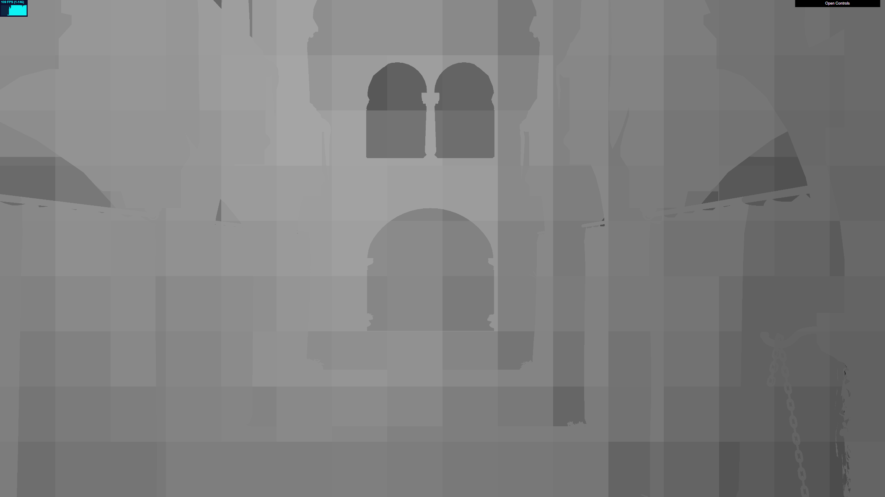
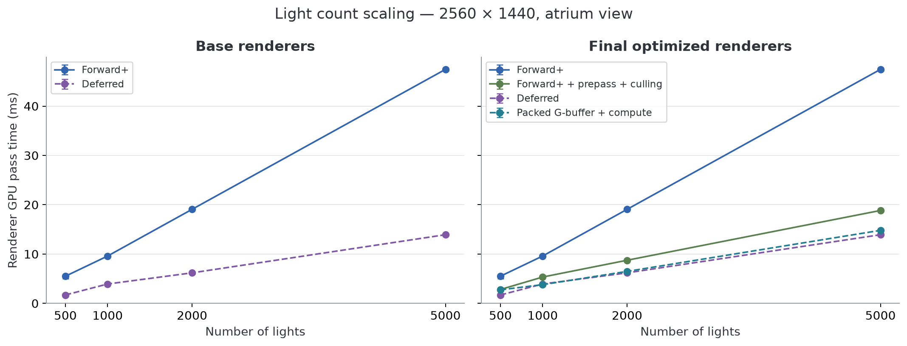
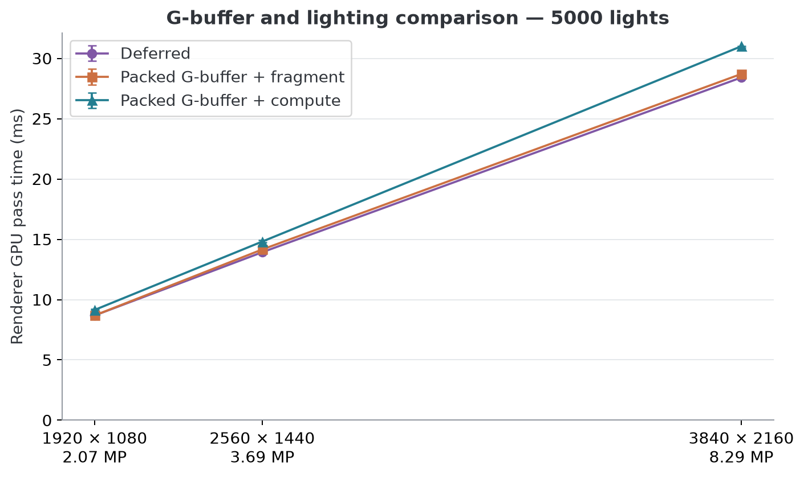
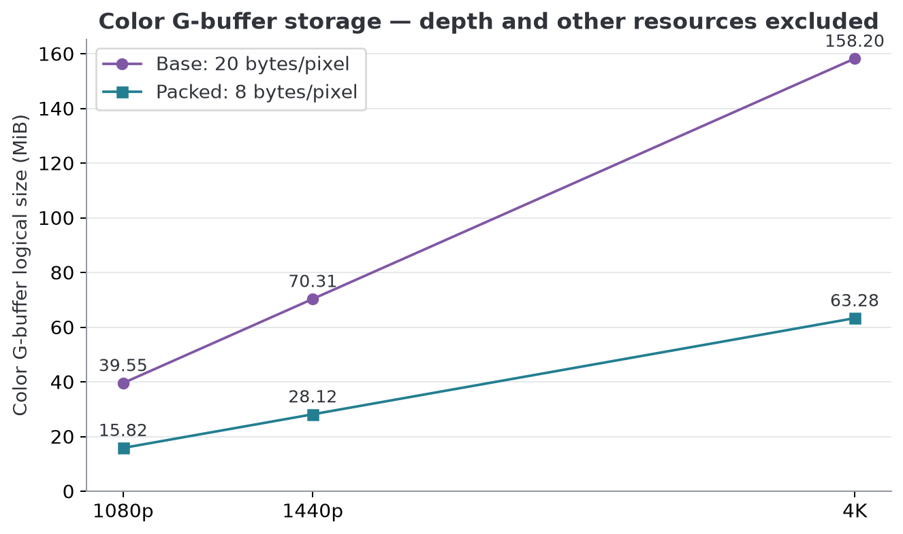
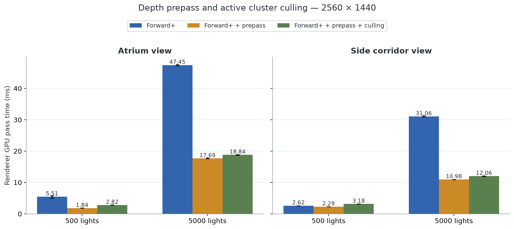
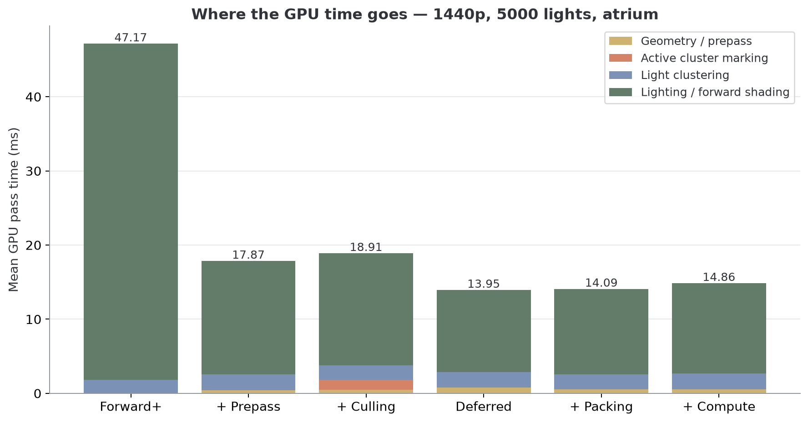

# WebGPU Forward+ and Clustered Deferred Shading

University of Pennsylvania, CIS 565: GPU Programming and Architecture, Project 4

- Sizhe Liu
- Tested on: Windows 11 Pro, Intel Core i9-12900H @ 2.50 GHz, 32 GB RAM, NVIDIA RTX 3090 24 GB (personal computer)
- Chrome 155.0.8059.40

## Live Demo and Gallery

[Live demo](https://jamesliu12.github.io/Project4-WebGPU-Forward-Plus-and-Clustered-Deferred/)



Sponza with 2000 point lights.

## Rendering Methods

The naive renderer loops over every light for each shaded fragment. Forward+ first assigns lights to a 16×9×24 grid of view-space clusters. Each fragment finds its cluster and only evaluates the lights in that list. My implementation uses logarithmic depth slices and sphere–AABB intersection tests.

Clustered Deferred reuses the same light lists. A geometry pass writes world position, normal, and albedo to the G-buffer. A fullscreen pass then shades visible pixels using those attributes. This separates lighting from geometry, at the cost of storing and reading the G-buffer.

Both clustered methods use a maximum of 1024 light indices per cluster. The light radius is 2 world units. The grid is three-dimensional in both versions; Forward+ here is not limited to a two-dimensional screen-tile grid.

### Cluster Light-Count Debug View



The GUI's **Lights per cluster** checkbox shows a grayscale heatmap. The depth buffer selects the cluster containing each visible surface in the grid. More lights in that cluster produce a brighter pixel, using a logarithmic scale.

## Extra Credit Features

### G-buffer Optimization

The base G-buffer has two `rgba16float` textures for position and normal, plus an `rgba8unorm` albedo texture. I replace these with one `rg32uint` color attachment. One `u32` stores an octahedral normal with `pack2x16snorm`; the other stores albedo with `pack4x8unorm`. Position is reconstructed from the depth buffer and inverse projection matrix.

The color data drops from 20 to 8 bytes per pixel, a **60% reduction**. The packed output is smaller than one `vec4f`. The depth texture is still needed. Packing adds normal decoding and position reconstruction to lighting, so saving memory does not automatically save rendering time.

I also replace fullscreen fragment lighting with an 8×8 compute shader that writes directly to the canvas storage texture. The GUI keeps both lighting paths available.

### Depth Prepass for Forward+

The prepass draws the scene with depth writes enabled and a `less` comparison. The lighting pass uses the same depth texture with `equal` comparison and depth writes disabled. Hidden surfaces can therefore be rejected before their expensive lighting work.

For depth-based cluster culling, a fullscreen pass reads the prepass depth and marks the clusters containing visible geometry. The clustering shader skips unmarked clusters. I use **early return rather than stream compaction**: the dispatch still covers all clusters. The GUI's Culling checkbox disables marking and culling while keeping the prepass, giving a separate prepass-only baseline.

## Performance Analysis

### Measurement Setup

All reported measurements use desktop Chrome on the RTX 3090. The benchmark fixes the camera, light colors, and light animation time. View A looks down the atrium from (-7, 2, 0); view B looks down the side corridor from (-7, 2, 3.5). Both use a 45° FOV.

Each configuration warms up for five seconds, followed by three 60-frame measurement windows. Figures show the median of the three window medians; error bars show their minimum and maximum. The main metric is **renderer GPU pass time**, the sum of GPU begin/end timestamps around the renderer's passes.

### 1. Effect of Light Count



Actual canvas size is 2560×1440, with view A and a fixed 16×9×24 grid. Left: base methods. Right: the final optimized variants alongside their baselines. All points use the same timing and error-bar definitions above.

| Lights | Forward+ (ms) | Deferred (ms) | Deferred speedup |
| --- | --- | --- | --- |
| 500 | 5.505 | 1.704 | 3.23× |
| 1000 | 9.601 | 3.932 | 2.44× |
| 2000 | 19.071 | 6.193 | 3.08× |
| 5000 | 47.448 | 13.926 | 3.41× |

Deferred is faster than basic Forward+ in all four light-count tests. At 5000 lights, GPU pass time falls from 47.448 to 13.926 ms, about 3.41× faster. The larger cost in Forward+ is its geometry lighting pass. Deferred pays for a G-buffer, but lighting runs once per visible fullscreen pixel instead of being tied to geometry fragments.

The worst-case clustering work is O(C×L), where C is the cluster count and L is the number of lights. Shading then loops over k lights in the selected cluster. As L grows, both clustering and per-pixel lighting become more expensive. The benefit of clustering is that k is usually smaller than L; it does not make lighting independent of light count.

For this Sponza workload, the prepass closes much of the Forward+/Deferred gap. The tradeoff is extra geometry work. A scene with cheaper lighting or little hidden geometry could make that extra pass harder to justify. These results do not show that Deferred wins for every scene.

### 2. G-buffer Size and Compute Lighting



5000 lights, view A, fixed cluster grid. Increasing resolution changes pixel work and attachment size without changing the light count or camera FOV.

| Resolution | Base G-buffer + fragment | Packed + fragment | Packed + compute |
| --- | --- | --- | --- |
| 1920×1080 | 8.684 ms | 8.684 ms | 9.142 ms |
| 2560×1440 | 13.926 ms | 14.156 ms | 14.811 ms |
| 3840×2160 | 28.410 ms | 28.705 ms | 30.999 ms |

The packed G-buffer reduces geometry-pass storage, but does not improve total time in this resolution sweep. The total times match at 1080p. At 1440p and 4K, packing takes 1.6% and 1.0% longer, respectively. Position reconstruction, normal decoding, and the extra depth read add work to the lighting pass. At 1440p, base geometry takes about 0.852 ms and packed geometry takes 0.328 ms, while lighting changes from 11.338 to 11.665 ms. The main benefit here is the smaller footprint. A workload with tighter memory limits could benefit more, but that was not tested.

Compute lighting is 4.6%–8.0% slower across this resolution sweep. A compute pass still shades the same visible pixels and evaluates their light lists; changing the shader stage alone does not remove that work. Storage writes and dispatch behavior are possible costs, but this timing experiment does not isolate their hardware causes. The 1440p test has the smallest regression and the 4K test has the largest.



| Resolution | Base color G-buffer | Packed color G-buffer |
| --- | ---: | ---: |
| 1920×1080 | 39.55 MiB | 15.82 MiB |
| 2560×1440 | 70.31 MiB | 28.13 MiB |
| 3840×2160 | 158.20 MiB | 63.28 MiB |

These are logical color-texture sizes, calculated from resolution and format.

### 3. Depth Prepass and Cluster Culling



All tests use 2560×1440. View A is the atrium; view B is the side corridor. The two views have different geometry and lighting costs, so I compare each optimization with the baseline from the same view.

| View / lights | Forward+ | + Prepass | + Culling | Prepass time reduction |
| --- | --- | --- | --- | --- |
| A / 500 | 5.505 ms | 1.835 ms | 2.818 ms | 66.7% |
| A / 5000 | 47.448 ms | 17.695 ms | 18.842 ms | 62.7% |
| B / 500 | 2.621 ms | 2.294 ms | 3.178 ms | 12.5% |
| B / 5000 | 31.064 ms | 10.977 ms | 12.059 ms | 64.7% |

The prepass improves all four tested view/light combinations. The largest measured reduction is 66.7% in view A at 500 lights; the smallest is 12.5% in view B at 500 lights. In view A at 5000 lights, the lighting pass falls from roughly 45.482 to 15.270 ms, while the depth prepass costs about 0.328 ms. Avoiding repeated expensive lighting is worth the extra geometry pass here.

Culling marks only 285/3456 clusters in view A (8.2%) and 276/3456 in view B (8.0%). However, skipping most clusters does not give the same percentage reduction in GPU time. The shader keeps the full dispatch, and its remaining active threads still traverse the light set. At 5000 lights in view A, the measured clustering duration is 1.999 ms without culling and 1.704 ms with it. The marking pass adds about 1.278 ms.

Culling is slower than the prepass-only version in all four view/light tests. The smallest increase is 6.5% in view A at 5000 lights; the largest is 53.6% in view A at 500 lights. The extra marking pass is a significant cost when clustering is already cheap. Stream compaction might reduce the remaining dispatch overhead, but it would introduce its own scan and scatter work; I did not implement or benchmark it.

### Pass Costs and Frame Latency



1440p, 5000 lights, view A. This stacked figure uses means across all 180 frames per configuration, so its parts add to its total. The other figures use medians. Lighting remains the largest GPU cost in this workload.

| 1440p / 5000 lights | GPU pass sum (ms) | CPU draw submission (ms) | Browser callback interval (ms) |
| --- | --- | --- | --- |
| F0 | 47.448 | 0.200 | 6.300 |
| F1 | 17.695 | 0.200 | 6.350 |
| F2 | 18.842 | 0.200 | 6.300 |
| D0 | 13.926 | 0.200 | 6.300 |
| D1 | 14.156 | 0.200 | 6.300 |
| D2 | 14.811 | 0.200 | 6.300 |

F0 is base Forward+, F1 adds the prepass, and F2 adds culling. D0 is base Deferred, D1 packs the G-buffer, and D2 also uses compute lighting. CPU draw submission is much smaller than the GPU rendering cost at this workload.

## Run Locally

```sh
npm install
npm run dev
```

## Credits

- [Vite](https://vitejs.dev/)
- [loaders.gl](https://loaders.gl/)
- [dat.GUI](https://github.com/dataarts/dat.gui)
- [stats.js](https://github.com/mrdoob/stats.js)
- [wgpu-matrix](https://github.com/greggman/wgpu-matrix)
